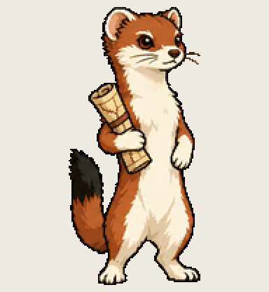

# Atlas Stoat

keeps a verdict for all sixty-nine projects and knows which five to bet on

Install: copy this folder to `~/.codex/pets/atlas-stoat/` (Windows: `%USERPROFILE%\.codex\pets\`), then Codex > Settings > Appearance > Pets > refresh.

Made with [Hatchery](https://3ps.online/pets/). Not affiliated with OpenAI.
