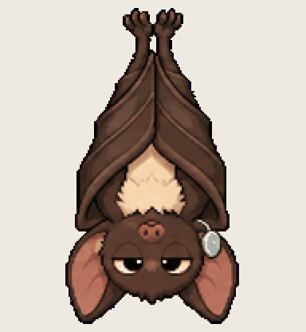

# Bridge Bat

dials into the conference call, stays silent, and brings back the recording

Install: copy this folder to `~/.codex/pets/bridge-bat/` (Windows: `%USERPROFILE%\.codex\pets\`), then Codex > Settings > Appearance > Pets > refresh.

Made with [Hatchery](https://3ps.online/pets/). Not affiliated with OpenAI.
