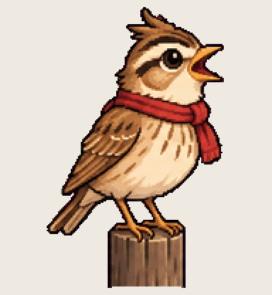

# Chorus Lark

ten voices in one morning and not one of them sounds like the others

Install: copy this folder to `~/.codex/pets/chorus-lark/` (Windows: `%USERPROFILE%\.codex\pets\`), then Codex > Settings > Appearance > Pets > refresh.

Made with [Hatchery](https://3ps.online/pets/). Not affiliated with OpenAI.
