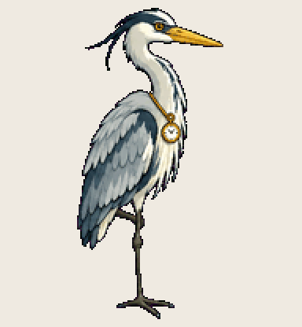

# Dispatch Heron

stands in the calendar all week and picks off each job right on time

Install: copy this folder to `~/.codex/pets/dispatch-heron/` (Windows: `%USERPROFILE%\.codex\pets\`), then Codex > Settings > Appearance > Pets > refresh.

Made with [Hatchery](https://3ps.online/pets/). Not affiliated with OpenAI.
