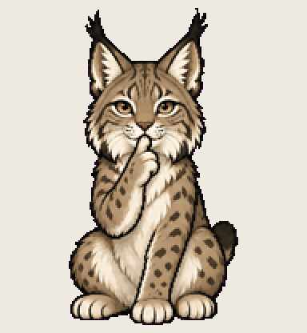

# Hush Lynx

says one thing, once, and tells you exactly why

Install: copy this folder to `~/.codex/pets/hush-lynx/` (Windows: `%USERPROFILE%\.codex\pets\`), then Codex > Settings > Appearance > Pets > refresh.

Made with [Hatchery](https://3ps.online/pets/). Not affiliated with OpenAI.
