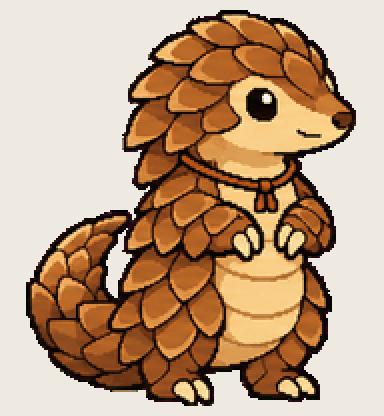

# Pocket Pangolin

curls up small to fit a round screen and stops running out of memory

Install: copy this folder to `~/.codex/pets/pocket-pangolin/` (Windows: `%USERPROFILE%\.codex\pets\`), then Codex > Settings > Appearance > Pets > refresh.

Made with [Hatchery](https://3ps.online/pets/). Not affiliated with OpenAI.
