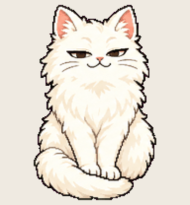

# Studio Cat

sits in the ring light and steals the whole frame

Install: copy this folder to `~/.codex/pets/studio-cat/` (Windows: `%USERPROFILE%\.codex\pets\`), then Codex > Settings > Appearance > Pets > refresh.

Made with [Hatchery](https://3ps.online/pets/). Not affiliated with OpenAI.
