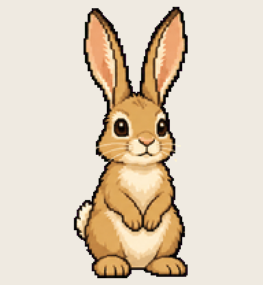

# Wake Hare

hears its name from across the house and is already listening

Install: copy this folder to `~/.codex/pets/wake-hare/` (Windows: `%USERPROFILE%\.codex\pets\`), then Codex > Settings > Appearance > Pets > refresh.

Made with [Hatchery](https://3ps.online/pets/). Not affiliated with OpenAI.
